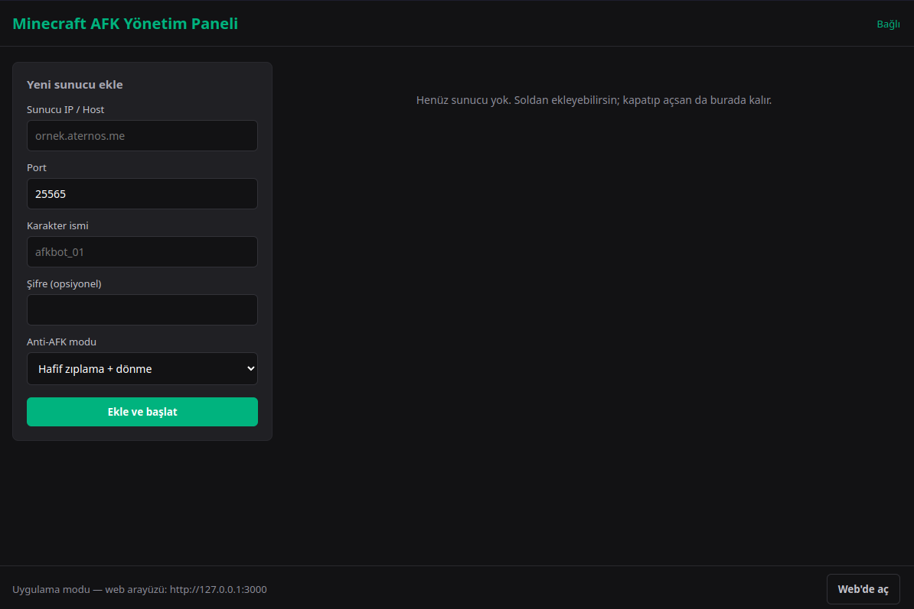

# MC AFK Panel

    npm install
    npm start        # masaüstü uygulaması (Electron)
    npm run web      # sadece tarayıcı: http://127.0.0.1:3000
    npm run dist     # AppImage üretir (dist/)

Sunucu listesi kalıcıdır (`~/.config/mc-afk-panel/bots.json`, web modunda `./data/bots.json`).
Aç/kapa anahtarı durumu da kaydedilir: uygulamayı açtığında "açık" olanlar otomatik bağlanır.

# NOT

yazılımcı degilseniz veya ugrasmak istemiyorsanız releases den derlenmis çalışmaya hazır doysyaları indirebilirsiniz
